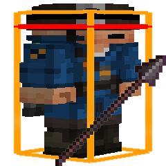

# Spear+CombatHitboxes

See when your target is within spear reach. A client-side mod that works on its own or alongside Combat Hitboxes and Combat Hitboxes+.

**[Download on Modrinth](https://modrinth.com/mod/spear-plus-combat-hitboxes)**

## Features

- **Orange at spear range, red at normal melee range.** Keep a spear anywhere in your hotbar, even while holding another item.
- **Custom colors and line widths.** Make the highlights look how you want.
- **Integrated settings.** A Spear category inside Combat Hitboxes’ settings, plus a standalone settings screen.
- **Optional accurate hitbox overlay.** Show the spear’s extra targeting margin while keeping the original white hitbox visible. Disabled by default.
- **Standalone or compatible.** Use vanilla hitboxes with **F3+B**, Combat Hitboxes, or Combat Hitboxes+.
- **Fabric and NeoForge support.** For Minecraft versions with vanilla spears.

Highlights show reach; they do not change your attacks or guarantee a hit.
